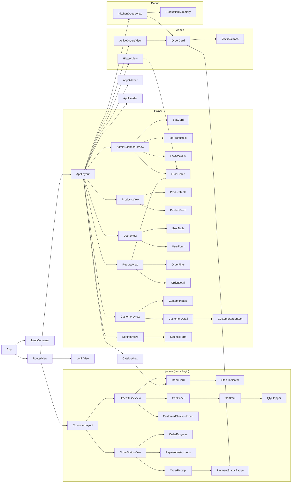
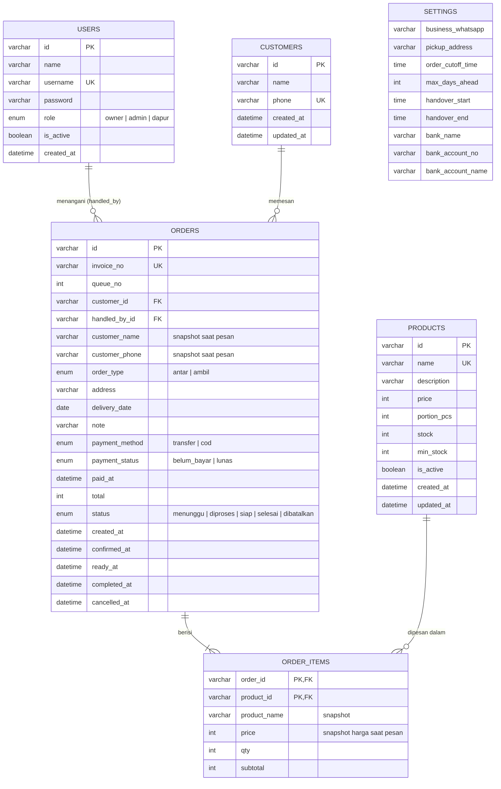

# Perancangan SIM Bakoel Bunda (Bahan Laporan UTS)

Dokumen ini adalah bahan untuk **Bab 2** (perancangan) dan **Bab 5** (pengujian) laporan UTS Pemrograman Berbasis Komponen. Semua nama halaman, komponen, store, dan field di sini sama persis dengan kode di folder `src/`.

Diagram ditulis dalam format **Mermaid**. Untuk dijadikan gambar di laporan, salin blok `mermaid` ke <https://mermaid.live> lalu unduh sebagai PNG/SVG. Pratinjau Markdown di VS Code dengan ekstensi Mermaid juga bisa.

---

## 2.1 Diagram Hirarki Komponen (Component Tree)



Komponen `common/` (BaseButton, BaseInput, BaseSelect, BaseTextarea, BaseTable, BaseModal, BaseBadge, ConfirmDialog, EmptyState, PageHeader, SearchBar, StatCard) dipakai di hampir semua cabang. Supaya diagram tetap terbaca, komponen ini tidak digambar satu per satu.

### Komponen Reusable

| Komponen | Dipakai di | Props utama | Emits / v-model |
|---|---|---|---|
| `BaseButton` | semua halaman | `variant`, `size`, `type`, `block`, `disabled` | klik native |
| `BaseInput` | form login, menu, pengguna, pesanan, pengaturan, filter | `label`, `type`, `error`, `hint`, `required` | `v-model` |
| `BaseSelect` | UserForm, OrderFilter | `label`, `options`, `placeholder`, `error` | `v-model` |
| `BaseTextarea` | ProductForm, CustomerCheckoutForm, SettingsForm | `label`, `rows`, `maxlength`, `error` | `v-model` |
| `BaseTable` | ProductTable, UserTable, OrderTable, CustomerTable, ProductionSummary | `columns`, `rows`, `rowKey`, `emptyText` | slot `#cell-<key>` |
| `BaseModal` | ProductForm, UserForm, OrderDetail | `show`, `title`, `width` | `close` |
| `BaseBadge` | status pesanan, status bayar, stok, role | `variant` | – |
| `ConfirmDialog` | hapus menu/pengguna, tolak/batalkan pesanan, reset data | `show`, `title`, `message`, `confirmText` | `confirm`, `cancel` |
| `PageHeader` | semua halaman staf | `title`, `subtitle` | slot aksi |
| `SearchBar` | menu, katalog, riwayat, pelanggan | `placeholder` | `v-model` |
| `StatCard` | dashboard, laporan, riwayat | `label`, `value`, `hint`, `variant` | – |
| `AppIcon` | sidebar, kartu pesanan | `name`, `size` | – |
| `EmptyState` | semua daftar | `title`, `description` | slot aksi |
| `MenuCard` | halaman pemesanan, katalog | `product`, `selectable`, `qtyInCart` | `add(productId)` |
| `OrderCard` | Pesanan Aktif, Antrean Dapur | `order`, `actions`, `today`, `showContact`, `canMarkPaid` | `action({order,status})`, `mark-paid(order)` |
| `OrderTable` | dashboard, laporan, riwayat | `orders` | `detail(order)` |
| `OrderDetail` | dashboard, laporan, riwayat | `show`, `order`, `title` | `close` |
| `OrderStatusBadge` / `PaymentStatusBadge` | kartu, tabel, struk | `status` | – |
| `CartPanel` | halaman pemesanan | `lines`, `total`, `totalQty`, `error` | `update-qty`, `remove`, `clear` |

---

## 2.2 Pemetaan Halaman, Role, Fitur, dan Spesifikasi API

Aplikasi ini belum memakai server, karena data disimpan di `localStorage`. Kolom **Aksi Store** menunjukkan fungsi Pinia yang sekarang menjalankan peran endpoint tersebut. Jika nanti dibuat backend, fungsi itulah yang diganti dengan pemanggilan HTTP.

| Nama Halaman | Role Pengakses | Nama Fitur | Endpoint API | Method | Aksi Store |
|---|---|---|---|---|---|
| Login | Semua staf | Masuk sistem | `/api/v1/auth/login` | POST | `auth.login()` |
| Pemesanan (`/pesan`) | Pembeli | Tampilkan menu aktif | `/api/v1/products?active=true` | GET | `products.activeProducts` |
| Pemesanan (`/pesan`) | Pembeli | Kirim pesanan PO | `/api/v1/orders` | POST | `orders.createOrder()` |
| Status Pesanan | Pembeli | Lihat status pesanan | `/api/v1/orders/:id` | GET | `orders.getById()` |
| Pesanan Aktif | Admin | Daftar pesanan per status | `/api/v1/orders?status=menunggu` | GET | `orders.pendingOrders` / `kitchenQueue` / `readyOrders` |
| Pesanan Aktif | Admin, Dapur | Ubah status pesanan | `/api/v1/orders/:id/status` | PATCH | `orders.updateStatus()` |
| Pesanan Aktif | Admin, Owner | Tandai lunas | `/api/v1/orders/:id/payment` | PATCH | `orders.markPaid()` |
| Riwayat Pesanan | Admin | Cari pesanan | `/api/v1/orders?search=` | GET | `orders.filterOrders()` |
| Antrean Dapur | Dapur | Rekap produksi per tanggal | `/api/v1/kitchen/production` | GET | `summarizeProduction()` |
| Kelola Menu | Owner | Daftar menu | `/api/v1/products` | GET | `products.sorted` |
| Kelola Menu | Owner | Tambah menu | `/api/v1/products` | POST | `products.addProduct()` |
| Kelola Menu | Owner | Ubah menu | `/api/v1/products/:id` | PUT | `products.updateProduct()` |
| Kelola Menu | Owner | Hapus menu | `/api/v1/products/:id` | DELETE | `products.removeProduct()` |
| Kelola Pengguna | Owner | Daftar / tambah / ubah / hapus | `/api/v1/users[/:id]` | GET/POST/PUT/DELETE | `users.addUser()`, `updateUser()`, `removeUser()` |
| Data Pelanggan | Owner | Daftar pelanggan | `/api/v1/customers` | GET | `customers.items` |
| Data Pelanggan | Owner | Detail & riwayat pesanan pelanggan | `/api/v1/customers/:id/orders` | GET | `orders.ordersByCustomer()` |
| Laporan Penjualan | Owner | Rekap omzet dengan filter | `/api/v1/reports/sales` | GET | `orders.filterOrders()` + `summarize()` |
| Pengaturan Toko | Owner | Lihat pengaturan | `/api/v1/settings` | GET | `settings.data` |
| Pengaturan Toko | Owner | Ubah pengaturan | `/api/v1/settings` | PUT | `settings.updateSettings()` |
| Katalog Menu | Owner, Admin, Dapur | Lihat katalog | `/api/v1/products` | GET | `products.sorted` |

Pesan error di contoh response 400 berikut **sama persis** dengan pesan dari `src/utils/validators.js` dan store.

### Login
- **Method dan Path:** `POST /api/v1/auth/login`
- **Request Body:**
  ```json
  { "username": "admin", "password": "admin123" }
  ```
- **Response Sukses (200):**
  ```json
  { "data": { "id": "usr-002", "name": "Rina (Admin)", "username": "admin", "role": "admin" } }
  ```
- **Response Gagal (401):**
  ```json
  { "message": "Username atau kata sandi salah." }
  ```

### Kirim Pesanan PO
- **Method dan Path:** `POST /api/v1/orders`
- **Request Body:**
  ```json
  {
    "customerName": "Budi",
    "customerPhone": "089911112222",
    "orderType": "antar",
    "address": "Jl. Kenanga No. 5, RT 02/RW 04",
    "deliveryDate": "2026-11-13",
    "note": "Saus dipisah",
    "paymentMethod": "transfer",
    "items": [{ "productId": "prd-001", "qty": 2 }]
  }
  ```
- **Response Sukses (201):**
  ```json
  {
    "data": {
      "id": "ord-m3x9k2ab",
      "invoiceNo": "BKB-20261112-0004",
      "queueNo": 4,
      "customerId": "cus-005",
      "deliveryDate": "2026-11-13",
      "status": "menunggu",
      "paymentMethod": "transfer",
      "paymentStatus": "belum_bayar",
      "items": [{ "productId": "prd-001", "name": "Dimsum Ayam Saus Biasa", "price": 18000, "qty": 2, "subtotal": 36000 }],
      "total": 36000,
      "createdAt": "2026-11-12T03:00:00.000Z"
    }
  }
  ```
- **Response Gagal (400):**
  ```json
  {
    "errors": {
      "deliveryDate": "Pesanan paling cepat untuk Jumat, 13 November 2026.",
      "address": "Alamat pengantaran wajib diisi.",
      "cart": "Stok \"Dimsum Ayam Saus Biasa\" tidak cukup (sisa 3 porsi)."
    }
  }
  ```

### Ubah Status Pesanan
- **Method dan Path:** `PATCH /api/v1/orders/:id/status`
- **Request Body:**
  ```json
  { "status": "selesai" }
  ```
- **Response Sukses (200):**
  ```json
  { "message": "Pesanan #2 atas nama Andi sudah diserahkan." }
  ```
- **Response Gagal (400 / 403):**
  ```json
  { "message": "Pesanan belum lunas. Tandai lunas terlebih dahulu." }
  ```
  ```json
  { "message": "Perubahan status ini tidak diizinkan." }
  ```

### Tandai Lunas
- **Method dan Path:** `PATCH /api/v1/orders/:id/payment`
- **Request Body:**
  ```json
  { "paymentStatus": "lunas" }
  ```
- **Response Sukses (200):**
  ```json
  { "message": "Pesanan #3 atas nama Andi ditandai lunas." }
  ```
- **Response Gagal (400):**
  ```json
  { "message": "Pesanan ini sudah lunas." }
  ```

### Tambah Menu
- **Method dan Path:** `POST /api/v1/products`
- **Request Body:**
  ```json
  { "name": "Dimsum Ayam Mentai", "description": "Dimsum ayam saus mentai bakar.", "price": 28000, "portionPcs": 5, "stock": 20, "minStock": 5, "isActive": true }
  ```
- **Response Sukses (201):**
  ```json
  { "data": { "id": "prd-m3xa1b2c", "name": "Dimsum Ayam Mentai", "price": 28000, "portionPcs": 5, "stock": 20, "minStock": 5, "isActive": true } }
  ```
- **Response Gagal (400):**
  ```json
  { "errors": { "name": "Nama menu sudah digunakan.", "price": "Harga harus lebih dari 0." } }
  ```

### Ubah Pengaturan Toko
- **Method dan Path:** `PUT /api/v1/settings`
- **Request Body:**
  ```json
  {
    "businessWhatsApp": "081234567890",
    "pickupAddress": "Jl. Melati No. 12, RT 03/RW 05",
    "orderCutoffTime": "20:00",
    "maxDaysAhead": 7,
    "handoverStart": "10:00",
    "handoverEnd": "17:00",
    "bankName": "BCA",
    "bankAccountNo": "1234567890",
    "bankAccountName": "Bunda"
  }
  ```
- **Response Sukses (200):** objek pengaturan yang sama.
- **Response Gagal (400):**
  ```json
  { "errors": { "handoverEnd": "Jam selesai harus setelah jam mulai.", "bankAccountNo": "Nomor rekening hanya angka, 6-20 digit." } }
  ```

### Tambah Pengguna
- **Method dan Path:** `POST /api/v1/users`
- **Request Body:**
  ```json
  { "name": "Dewi Dapur 2", "username": "dapur2", "password": "dapur123", "role": "dapur" }
  ```
- **Response Sukses (201):**
  ```json
  { "data": { "id": "usr-m3xb9z1q", "name": "Dewi Dapur 2", "username": "dapur2", "role": "dapur", "isActive": true } }
  ```
- **Response Gagal (400):**
  ```json
  { "errors": { "username": "Username sudah digunakan.", "password": "Kata sandi minimal 6 karakter." } }
  ```

---

## 2.3 Desain Basis Data (ERD)



**Penjelasan relasi:**
- **CUSTOMERS 1 – N ORDERS.** Satu pelanggan (dikenali dari nomor WhatsApp) bisa punya banyak pesanan, sedangkan satu pesanan hanya milik satu pelanggan (`orders.customer_id`).
- **ORDERS 1 – N ORDER_ITEMS.** Satu pesanan berisi minimal satu item menu.
- **PRODUCTS 1 – N ORDER_ITEMS.** Satu menu bisa muncul di banyak item pesanan. `ORDER_ITEMS` adalah tabel penghubung relasi *many-to-many* antara ORDERS dan PRODUCTS.
- **USERS 1 – N ORDERS.** Satu Admin bisa menangani banyak pesanan (`orders.handled_by_id`, boleh kosong selama pesanan belum dikonfirmasi).
- **SETTINGS** hanya berisi satu baris konfigurasi toko, sehingga tidak berelasi dengan tabel lain.
- `customer_name`, `customer_phone`, `product_name`, dan `price` di pesanan sengaja disimpan sebagai **snapshot**. Tujuannya supaya riwayat dan laporan tidak berubah ketika nama pelanggan atau harga menu diubah kemudian.

Di `localStorage`, `order_items` disimpan sebagai array `items` di dalam setiap objek pesanan (kunci `bakoelbunda_orders`). Untuk keperluan perancangan, tabel ini tetap digambar terpisah agar ternormalisasi.

---

## 2.4 Panduan Gaya Visual (Style Guide)

Sumber: `src/assets/styles/variables.css`. Warna diambil dari dapur dimsum: daun pisang, uap, bambu kukusan, dan sambal.

### Palet Warna

| Peran | Token | HEX |
|---|---|---|
| Primary (daun pisang) | `--color-primary` | `#1E5A3C` |
| Primary gelap | `--color-primary-dark` | `#154530` |
| Secondary (bambu kukusan) | `--color-secondary` | `#C99A4B` |
| Aksen harga & antrean (sambal) | `--color-chili` | `#C8321F` |
| Sukses | `--color-success` | `#257549` |
| Peringatan | `--color-warning` | `#B7791F` |
| Teks peringatan | `--color-warning-text` | `#8A5A12` |
| Bahaya | `--color-danger` | `#B42D1C` |
| Info | `--color-info` | `#2A6F97` |
| Latar (uap) | `--color-bg` | `#EEF3EE` |
| Permukaan kartu | `--color-surface` | `#FFFFFF` |
| Teks | `--color-text` | `#1C2621` |
| Teks sekunder | `--color-text-muted` | `#5B6A61` |
| Garis kotak isian | `--color-input-border` | `#87958B` |

Semua pasangan teks–latar memenuhi kontras WCAG AA (≥ 4.5:1), dan garis kotak isian memenuhi ≥ 3:1.

### Tipografi

| Elemen | Font | Ukuran | Ketebalan |
|---|---|---|---|
| Semua teks | **Poppins** (Google Fonts) | – | – |
| Angka besar (omzet, nomor antrean) | Poppins | 32–44px | 700 |
| Judul halaman (`h1`) | Poppins | 25px | 700 |
| Subjudul (`h2`) | Poppins | 20px | 700 |
| Judul kartu (`h3`) | Poppins | 16px | 700 |
| Teks isi | Poppins | 15px | 400 |
| Teks kecil / keterangan | Poppins | 13px | 400–500 |

### Bentuk & Jarak
- Jarak memakai kelipatan 4px (`--space-1` 4px sampai `--space-8` 32px).
- Radius: 8px untuk tombol dan input, 14px untuk kartu dan panel.

### Desain Antarmuka
Rancangan visual (wireframe/mockup) diambil dari tangkapan layar aplikasi yang berjalan (`npm run dev`) untuk halaman: Pemesanan, Status Pesanan, Pesanan Aktif, Antrean Dapur, Dashboard, Laporan, dan Pengaturan Toko.

---

## 5.1 Daftar Skenario Pengujian Fitur

Kolom *Hasil Aktual* diisi setelah diuji manual di browser. Skenario bertanda **(auto)** juga sudah diuji otomatis di folder `tests/` (`npm test`).

| Kode Uji | Nama Fitur | Kondisi / Skenario Uji | Hasil yang Diharapkan | Hasil Aktual |
|---|---|---|---|---|
| QA-01 | Login | Login `admin` / `admin123` | Diarahkan ke halaman Pesanan Aktif **(auto)** | |
| QA-02 | Login | Username/kata sandi dikosongkan | Pesan "Username dan kata sandi wajib diisi." | |
| QA-03 | Login | Kata sandi salah / akun `kasir` lama | Pesan "Username atau kata sandi salah." **(auto)** | |
| QA-04 | Hak akses | Admin membuka `/owner/menu` | Diarahkan ke halaman 403 **(auto)** | |
| QA-05 | Hak akses | Membuka `/pesanan/aktif` tanpa login | Diarahkan ke halaman login | |
| QA-06 | Pemesanan | Pesan untuk besok, ambil ke rumah, bayar saat diterima, data lengkap | Pesanan terkirim, halaman status tampil, stok berkurang **(auto)** | |
| QA-07 | Pemesanan | Keranjang kosong | Tombol Kirim nonaktif / pesan "Keranjang masih kosong." | |
| QA-08 | Pemesanan | Nama dan WhatsApp kosong | Pesan wajib diisi pada kedua field **(auto)** | |
| QA-09 | Pemesanan | WhatsApp `123` | Pesan "Nomor WhatsApp tidak valid." | |
| QA-10 | Pemesanan | Pilih "Diantar kurir" tanpa alamat | Pesan "Alamat pengantaran wajib diisi." **(auto)** | |
| QA-11 | Tanggal PO | Pilih tanggal hari ini | Pesan "Pesanan paling cepat untuk …" **(auto)** | |
| QA-12 | Tanggal PO | Pilih tanggal H+8 (batas 7 hari) | Pesan "Pesanan paling lambat untuk …" **(auto)** | |
| QA-13 | Tanggal PO | Batas: pilih tepat H+7 | Pesanan diterima **(auto)** | |
| QA-14 | Jam batas | Pesan pukul 21.00 untuk besok | Pesanan diterima, nomor antrean di belakang, label "Pesanan susulan" **(auto)** | |
| QA-15 | Jam batas | Batas: pesan tepat pukul 20.00 vs 19.59 | 20.00 ditandai susulan, 19.59 tidak **(auto)** | |
| QA-16 | Stok | Jumlah melebihi sisa stok | Pesan "Stok … tidak cukup", stok tidak berubah **(auto)** | |
| QA-17 | Stok | Batas: tambah menu sampai stok habis | Tombol tambah berhenti di sisa stok, menu habis tidak bisa dipilih | |
| QA-18 | Pembayaran | Pesan dengan "Bayar di muka" | Halaman status menampilkan nomor rekening dan tombol kirim bukti WA | |
| QA-19 | Pembayaran | Tandai diserahkan saat belum lunas | Ditolak: "Pesanan belum lunas. Tandai lunas terlebih dahulu." **(auto)** | |
| QA-20 | Pembayaran | Tandai lunas lalu diserahkan | Status Lunas, lalu Selesai **(auto)** | |
| QA-21 | Pembayaran | Tandai lunas pesanan yang dibatalkan | Ditolak **(auto)** | |
| QA-22 | Konfirmasi | Admin menolak pesanan baru | Status Dibatalkan, stok kembali **(auto)** | |
| QA-23 | Dapur | Pesanan diterima Admin | Muncul di antrean dapur (tab lain tanpa reload) dan rekap produksi | |
| QA-24 | Dapur | Dua pesanan menu sama, tanggal sama | Rekap produksi menjumlahkan porsi dan pcs **(auto)** | |
| QA-25 | Dapur | Antrean berisi tanggal 15 dan 13 | Tanggal 13 tampil lebih dulu **(auto)** | |
| QA-26 | Kelola Menu | Simpan menu dengan harga 0 | Pesan "Harga harus lebih dari 0." | |
| QA-27 | Kelola Menu | Nama menu sama dengan yang sudah ada | Pesan "Nama menu sudah digunakan." | |
| QA-28 | Kelola Menu | Batas: stok 0 | Menu tersimpan, tampil "habis", tidak bisa dipesan | |
| QA-29 | Pengaturan Toko | Ubah jam batas jadi 19:00 lalu simpan | Tersimpan, info di halaman pemesanan ikut berubah | |
| QA-30 | Pengaturan Toko | Jam selesai 09:00, jam mulai 10:00 | Pesan "Jam selesai harus setelah jam mulai." **(auto)** | |
| QA-31 | Pengaturan Toko | Batas hari 0 atau 31 | Ditolak; 1 diterima **(auto)** | |
| QA-32 | Laporan | Filter "Status bayar: Belum bayar" | Hanya pesanan belum lunas yang tampil **(auto)** | |
| QA-33 | Laporan | Filter tanggal terima dari > sampai | Daftar kosong, omzet Rp0 | |
| QA-34 | Pelanggan | Pesan dua kali dengan WA `0899-1111-2222` dan `089911112222` | Tercatat sebagai satu pelanggan dengan 2 pesanan **(auto)** | |
| QA-34b | Pelanggan | Klik Detail pada pelanggan "Bu Rahma" | Modal menampilkan 2 pesanan beserta isi menu, total, status, dan menu yang sering dipesan **(auto)** | |
| QA-35 | Persistensi | Kirim pesanan lalu reload browser | Pesanan tetap ada di localStorage | |
| QA-36 | Persistensi | Data versi lama (role kasir) di localStorage | Data otomatis direset ke seed baru, aplikasi tidak error **(auto)** | |
| QA-37 | Persistensi | Klik "Reset Data Demo" | Semua data kembali ke isi seed JSON | |
| QA-38 | Data seed | Aplikasi pertama kali dibuka di tanggal lain (misalnya 20 Des) | Tanggal pesanan contoh ikut bergeser; dashboard tetap berisi pesanan hari ini **(auto)** | |
| QA-39 | Pelanggan | Pesan dengan WA `+62 899-1111-2222` lalu `089911112222` | Tercatat sebagai satu pelanggan **(auto)** | |
| QA-40 | Pembatalan | Admin membatalkan pesanan yang sudah lunas | Dialog mengingatkan pengembalian dana; halaman pembeli menampilkan info pengembalian | |

## 5.2 Bukti DevTools

Buka DevTools → **Application** → **Local Storage** → `http://localhost:5173`, lalu ambil tangkapan layar kunci `bakoelbunda_orders` sebelum dan sesudah QA-06/QA-20. Kunci `bakoelbunda_customers` diambil setelah QA-34, dan `bakoelbunda_settings` setelah QA-29.
