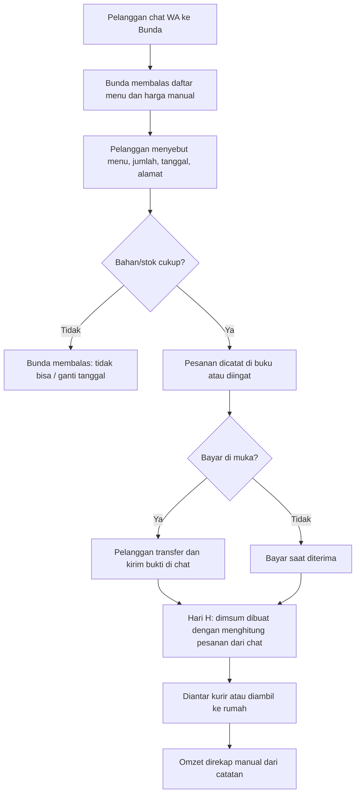
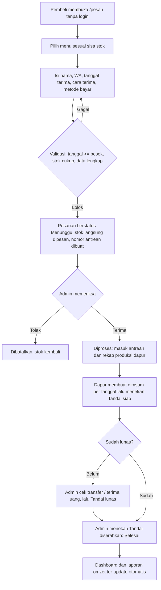
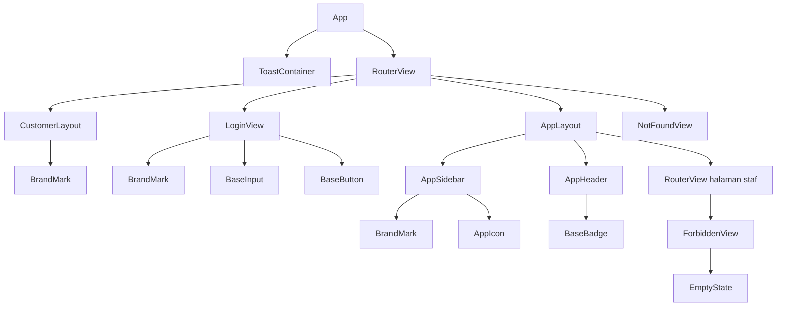
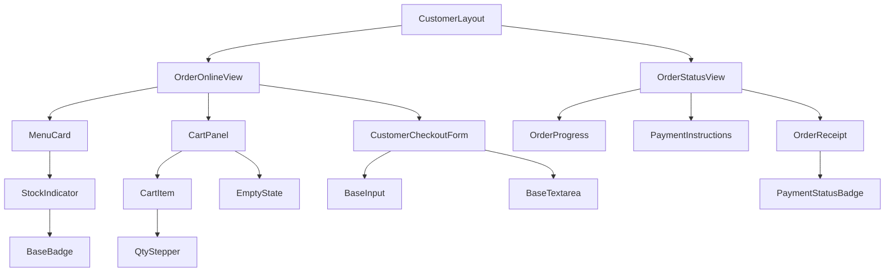
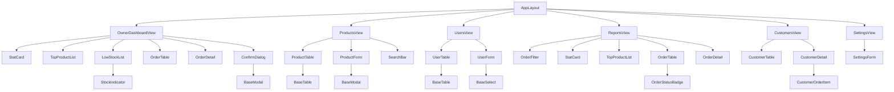
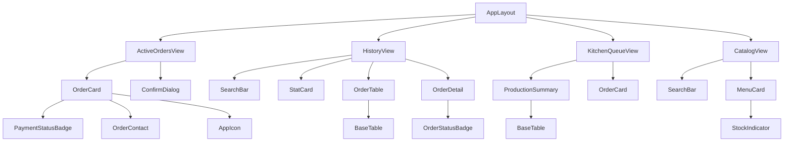
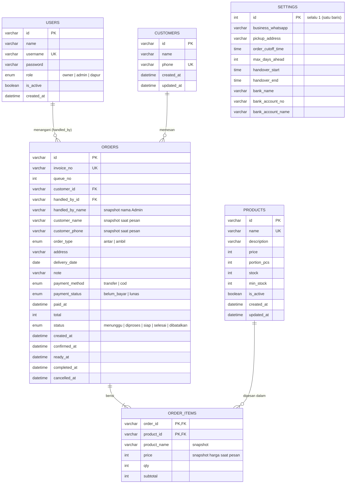
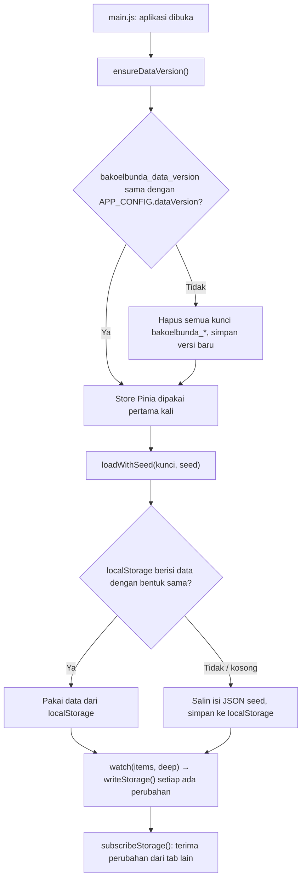

# Perancangan SIM Bakoel Bunda (Bahan Laporan UTS)

Dokumen ini adalah bahan laporan UTS Pemrograman Berbasis Komponen untuk **Bab 1** (analisis kebutuhan), **Bab 2** (perancangan), **Bab 3.2** (seed dan localStorage), dan **Bab 5** (pengujian). Bahan **Bab 4** (log Agentic AI) ada di file terpisah [`log-agentic-ai.md`](log-agentic-ai.md). Semua nama halaman, komponen, store, field, dan pesan error di sini sama persis dengan kode di folder `src/`.

Diagram ditulis dalam format **Mermaid**. Untuk dijadikan gambar di laporan, salin blok `mermaid` ke <https://mermaid.live> lalu unduh sebagai PNG/SVG. Pratinjau Markdown di VS Code dengan ekstensi Mermaid juga bisa.

**Judul sampul:** Sistem Informasi Manajemen Pre-Order Bakoel Bunda Berbasis Komponen
**Objek usaha:** Bakoel Bunda (UMKM dimsum ayam rumahan)

---

## Bab 1. Analisis Kebutuhan (bahan aspek A1)

### 1.1 Profil Objek Usaha

| Item | Isi |
|---|---|
| Nama usaha | Bakoel Bunda |
| Jenis usaha | UMKM makanan rumahan: dimsum ayam (saus biasa dan saus bolognese daging) |
| Pemilik | *[isi nama pemilik]* |
| Alamat | *[isi alamat usaha]* |
| Tanggal observasi / wawancara | *[isi tanggal]* |
| Bukti izin observasi | *[lampirkan surat izin bertanda tangan pemilik dan/atau foto bersama pemilik]* |

Ciri usaha yang menentukan rancangan sistem:
- **Tidak punya toko atau tempat makan.** Semua penjualan berupa pesanan.
- **Sistem pre-order (PO).** Dimsum baru dibuat setelah dipesan karena bahan belum tentu tersedia. Pesanan paling cepat untuk besok (H-1).
- **Diantar kurir atau diambil ke rumah.** Ongkir tidak dihitung di sistem.
- **Pembayaran** transfer bank di muka atau bayar saat dimsum diterima.
- **Usaha rumahan tidak buka 24 jam**, sehingga ada jam batas pesanan.

### 1.2 Alur Proses Bisnis

**Sebelum sistem (lewat chat WhatsApp):**



**Sesudah sistem (SIM Bakoel Bunda):**



Pesanan yang masuk setelah jam batas (bawaan 20:00) tetap bisa untuk besok, tetapi nomor antreannya di belakang pesanan yang masuk sebelum jam batas dan diberi label **Pesanan susulan**.

### 1.3 Kendala dan Harapan Pemilik Usaha

| No | Kendala nyata | Harapan pemilik | Fitur solusi |
|---|---|---|---|
| 1 | Pesanan masuk lewat chat WA dan sering terselip | Semua pesanan masuk ke satu tempat | Halaman pemesanan `/pesan` tanpa login + daftar Pesanan Aktif |
| 2 | Bahan belum tentu tersedia untuk pesanan dadakan | Pesanan minimal H-1 | Tanggal terima paling cepat besok, paling lambat sesuai pengaturan (bawaan 7 hari) |
| 3 | Usaha rumahan tidak bisa melayani 24 jam | Ada batas jam pesanan | Jam batas pesanan + label Pesanan susulan |
| 4 | Pembayaran campur: transfer dan bayar di tempat | Tahu pesanan mana yang belum dibayar | Metode bayar, status Belum bayar/Lunas, pesanan belum lunas tidak bisa diserahkan |
| 5 | Dapur harus menghitung sendiri jumlah yang dibuat | Rekap jumlah per hari | Rekap produksi (porsi dan pcs) per tanggal terima |
| 6 | Kuota produksi terbatas | Tidak menerima pesanan melebihi kemampuan | Stok per menu yang berkurang otomatis dan kembali saat pesanan dibatalkan |
| 7 | Omzet direkap manual | Laporan otomatis | Dashboard harian dan Laporan Penjualan dengan filter |
| 8 | Data pelanggan langganan tercecer di chat | Tahu pelanggan setia dan menu favoritnya | Data Pelanggan otomatis dari nomor WA + riwayat pesanan |

### 1.4 Pembagian Role dan Fitur

| Role | Siapa | Fitur |
|---|---|---|
| **Pembeli** (tanpa login) | Pelanggan | Lihat menu dan stok, pesan PO, pantau status pesanan, lihat instruksi transfer |
| **Owner** | Bunda (pemilik) | Dashboard, Kelola Menu dan stok, Kelola Pengguna, Laporan Penjualan, Data Pelanggan, Pengaturan Toko, Reset Data Demo, Katalog |
| **Admin** | Pegawai yang memegang WA/pesanan | Pesanan Aktif (terima/tolak, tandai lunas, tandai diserahkan, batalkan), Riwayat Pesanan, Katalog |
| **Dapur** | Pegawai produksi | Antrean Dapur, Rekap Produksi, Tandai siap, Katalog |

---

## 2.1 Diagram Hirarki Komponen (Component Tree)

Diagram dipecah per bagian supaya terbaca. Komponen `common/` kecil (BaseButton, BaseInput, BaseSelect, BaseTextarea, BaseBadge, EmptyState, PageHeader, SearchBar) yang dipakai di hampir semua halaman hanya digambar pada komponen yang memakainya langsung di bagian utama.

**a. Akar aplikasi dan layout**



**b. Halaman pembeli (`/pesan`, tanpa login)**



**c. Halaman Owner**



**d. Halaman Admin, Dapur, dan bersama**



### Komponen Reusable

| Komponen | Dipakai di | Props utama | Emits / v-model |
|---|---|---|---|
| `BaseButton` | semua halaman | `variant`, `size`, `type`, `block`, `disabled` | klik native |
| `BaseInput` | LoginView, ProductForm, UserForm, CustomerCheckoutForm, SettingsForm, OrderFilter | `label`, `type`, `error`, `hint`, `required` | `v-model` |
| `BaseSelect` | UserForm, OrderFilter | `label`, `options`, `placeholder`, `error` | `v-model` |
| `BaseTextarea` | ProductForm, CustomerCheckoutForm, SettingsForm | `label`, `rows`, `maxlength`, `error` | `v-model` |
| `BaseTable` | ProductTable, UserTable, OrderTable, CustomerTable, ProductionSummary | `columns`, `rows`, `rowKey`, `emptyText` | slot `#cell-<key>`; di HP (≤ 640px) tiap baris otomatis tampil sebagai kartu |
| `BaseModal` | ProductForm, UserForm, OrderDetail, CustomerDetail, ConfirmDialog | `show`, `title`, `width` | `close` |
| `BaseBadge` | status pesanan, status bayar, stok, role, label hari | `variant` | – |
| `ConfirmDialog` | hapus menu/pengguna, tolak/batalkan pesanan, reset data | `show`, `title`, `message`, `confirmText` | `confirm`, `cancel` |
| `PageHeader` | semua halaman staf | `title`, `subtitle` | slot aksi |
| `SearchBar` | Kelola Menu, Katalog, Riwayat, Data Pelanggan | `placeholder` | `v-model` |
| `StatCard` | Dashboard, Laporan, Riwayat | `label`, `value`, `hint`, `variant` | – |
| `QtyStepper` | CartItem (keranjang pembeli) | `min`, `max` | `v-model` (jumlah porsi) |
| `BrandMark` | LoginView, CustomerLayout, AppSidebar | `size` | – |
| `AppIcon` | AppSidebar, OrderCard | `name`, `size` | – |
| `EmptyState` | semua daftar, 403, 404 | `title`, `description` | slot aksi |
| `StockIndicator` | MenuCard, ProductTable, LowStockList | `stock`, `minStock` | – |
| `MenuCard` | Pemesanan, Katalog | `product`, `selectable`, `qtyInCart` | `add(productId)` |
| `OrderCard` | Pesanan Aktif, Antrean Dapur | `order`, `actions`, `today`, `showContact`, `canMarkPaid` | `action({order,status})`, `mark-paid(order)` |
| `OrderTable` | Dashboard, Laporan, Riwayat | `orders` | `detail(order)` |
| `OrderDetail` | Dashboard, Laporan, Riwayat | `show`, `order`, `title` | `close` |
| `OrderStatusBadge` / `PaymentStatusBadge` | kartu, tabel, struk, detail pelanggan | `status` | – |
| `CartPanel` | Pemesanan | `lines`, `total`, `totalQty`, `error` | `update-qty`, `remove`, `clear` |
| `ProductForm` / `UserForm` | Kelola Menu / Kelola Pengguna | `show`, `product`/`user`, `errors` | `close`, `submit` |
| `CustomerDetail` | Data Pelanggan | `show`, `customer`, `orders` | `close` |
| `OrderFilter` | Laporan | – | `v-model` (objek filter), `reset` |

---

## 2.2 Pemetaan Halaman, Role, Fitur, dan Spesifikasi API

Aplikasi ini belum memakai server, karena data disimpan di `localStorage`. Kolom **Aksi Store** menunjukkan fungsi Pinia yang sekarang menjalankan peran endpoint tersebut. Jika nanti dibuat backend, fungsi itulah yang diganti dengan pemanggilan HTTP.

| No | Nama Halaman | Role Pengakses | Nama Fitur | Endpoint API | Method | Aksi Store |
|---|---|---|---|---|---|---|
| E01 | Login | Owner, Admin, Dapur | Masuk sistem | `/api/v1/auth/login` | POST | `auth.login()` |
| E02 | Pemesanan (`/pesan`) | Pembeli | Tampilkan menu aktif | `/api/v1/products?active=true` | GET | `products.activeProducts` |
| E03 | Pemesanan (`/pesan`) | Pembeli | Kirim pesanan PO | `/api/v1/orders` | POST | `orders.createOrder()` |
| E04 | Status Pesanan | Pembeli | Lihat status pesanan | `/api/v1/orders/:id` | GET | `orders.getById()` |
| E05 | Pesanan Aktif | Admin | Daftar pesanan per status | `/api/v1/orders?status=` | GET | `orders.pendingOrders` / `kitchenQueue` / `readyOrders` |
| E06 | Pesanan Aktif, Antrean Dapur | Admin, Dapur | Ubah status pesanan | `/api/v1/orders/:id/status` | PATCH | `orders.updateStatus()` |
| E07 | Pesanan Aktif | Admin, Owner | Tandai lunas | `/api/v1/orders/:id/payment` | PATCH | `orders.markPaid()` |
| E08 | Riwayat Pesanan | Admin | Cari pesanan | `/api/v1/orders?search=` | GET | `orders.filterOrders()` |
| E09 | Antrean Dapur | Dapur | Rekap produksi per tanggal | `/api/v1/kitchen/production` | GET | `summarizeProduction()` |
| E10 | Kelola Menu, Katalog | Owner (Katalog: semua staf) | Daftar menu | `/api/v1/products` | GET | `products.sorted` |
| E11 | Kelola Menu | Owner | Tambah menu | `/api/v1/products` | POST | `products.addProduct()` |
| E12 | Kelola Menu | Owner | Ubah menu | `/api/v1/products/:id` | PUT | `products.updateProduct()` |
| E13 | Kelola Menu | Owner | Aktif/nonaktifkan menu | `/api/v1/products/:id/active` | PATCH | `products.toggleActive()` |
| E14 | Kelola Menu | Owner | Hapus menu | `/api/v1/products/:id` | DELETE | `products.removeProduct()` |
| E15 | Kelola Pengguna | Owner | Daftar pengguna | `/api/v1/users` | GET | `users.items` |
| E16 | Kelola Pengguna | Owner | Tambah pengguna | `/api/v1/users` | POST | `users.addUser()` |
| E17 | Kelola Pengguna | Owner | Ubah pengguna | `/api/v1/users/:id` | PUT | `users.updateUser()` |
| E18 | Kelola Pengguna | Owner | Aktif/nonaktifkan pengguna | `/api/v1/users/:id/active` | PATCH | `users.toggleActive()` |
| E19 | Kelola Pengguna | Owner | Hapus pengguna | `/api/v1/users/:id` | DELETE | `users.removeUser()` |
| E20 | Data Pelanggan | Owner | Daftar pelanggan + ringkasan | `/api/v1/customers` | GET | `customers.items` + ringkasan di `CustomersView` |
| E21 | Data Pelanggan | Owner | Detail & riwayat pesanan pelanggan | `/api/v1/customers/:id/orders` | GET | `orders.ordersByCustomer()` |
| E22 | Laporan Penjualan | Owner | Rekap omzet dengan filter | `/api/v1/reports/sales` | GET | `orders.filterOrders()` + `summarize()` |
| E23 | Pengaturan Toko | Owner | Lihat pengaturan | `/api/v1/settings` | GET | `settings.data` |
| E24 | Pengaturan Toko | Owner | Ubah pengaturan | `/api/v1/settings` | PUT | `settings.updateSettings()` |

**Catatan format:**
- Pesan error di contoh response 400/403/404/409 **sama persis** dengan pesan dari `src/utils/validators.js` dan store, kecuali "Status pesanan tidak dikenal." (E05) dan "Pelanggan tidak ditemukan." (E21). Dua pesan itu baru ada di rancangan backend, karena di aplikasi sekarang kondisinya tidak bisa terjadi lewat antarmuka.
- Response **401** (belum login) dan **403** (role tidak berhak) untuk endpoint staf tidak ditulis ulang di tiap endpoint. Di aplikasi, kondisi ini ditangani guard Vue Router: pengguna diarahkan ke halaman login atau halaman 403. Kontraknya:
  ```json
  { "message": "Silakan login terlebih dahulu." }
  ```
  ```json
  { "message": "Anda tidak memiliki akses ke halaman ini." }
  ```

### E01. Login
- **Method dan Path:** `POST /api/v1/auth/login`
- **Request Body:**
  ```json
  { "username": "admin", "password": "admin123" }
  ```
- **Response Sukses (200):**
  ```json
  { "data": { "id": "usr-002", "name": "Rina (Admin)", "username": "admin", "role": "admin" } }
  ```
- **Response Gagal (400 / 401 / 403):**
  ```json
  { "message": "Username dan kata sandi wajib diisi." }
  ```
  ```json
  { "message": "Username atau kata sandi salah." }
  ```
  ```json
  { "message": "Akun Anda dinonaktifkan. Hubungi Owner." }
  ```

### E02. Tampilkan Menu Aktif
- **Method dan Path:** `GET /api/v1/products?active=true`
- **Request Body:** – (tanpa body)
- **Response Sukses (200):**
  ```json
  {
    "data": [
      { "id": "prd-001", "name": "Dimsum Ayam Saus Biasa", "description": "Dimsum ayam kukus isi 5 dengan saus sambal khas Bakoel Bunda.", "price": 18000, "portionPcs": 5, "stock": 40, "minStock": 10, "isActive": true }
    ]
  }
  ```
- **Response Gagal:** – (daftar kosong dikembalikan sebagai `{ "data": [] }` dan ditampilkan sebagai EmptyState)

### E03. Kirim Pesanan PO
- **Method dan Path:** `POST /api/v1/orders`
- **Request Body:**
  ```json
  {
    "customerName": "Budi",
    "customerPhone": "089911112222",
    "orderType": "antar",
    "address": "Jl. Kenanga No. 5, RT 02/RW 04",
    "deliveryDate": "2026-11-13",
    "note": "Saus dipisah",
    "paymentMethod": "transfer",
    "items": [{ "productId": "prd-001", "qty": 2 }]
  }
  ```
- **Response Sukses (201):**
  ```json
  {
    "data": {
      "id": "ord-m3x9k2ab",
      "invoiceNo": "BKB-20261112-0004",
      "queueNo": 4,
      "customerId": "cus-005",
      "deliveryDate": "2026-11-13",
      "status": "menunggu",
      "paymentMethod": "transfer",
      "paymentStatus": "belum_bayar",
      "items": [{ "productId": "prd-001", "name": "Dimsum Ayam Saus Biasa", "price": 18000, "qty": 2, "subtotal": 36000 }],
      "total": 36000,
      "createdAt": "2026-11-12T03:00:00.000Z"
    }
  }
  ```
- **Response Gagal (400):**
  ```json
  {
    "errors": {
      "cart": "Stok \"Dimsum Ayam Saus Biasa\" tidak cukup (sisa 3 porsi).",
      "customerPhone": "Nomor WhatsApp tidak valid. Contoh: 081234567890.",
      "address": "Alamat pengantaran wajib diisi.",
      "deliveryDate": "Pesanan paling cepat untuk Jumat, 13 November 2026.",
      "paymentMethod": "Metode pembayaran wajib dipilih."
    }
  }
  ```

### E04. Lihat Status Pesanan
- **Method dan Path:** `GET /api/v1/orders/:id` (contoh: `/api/v1/orders/ord-009`)
- **Request Body:** –
- **Response Sukses (200):** objek pesanan lengkap seperti response E03, dengan `status` terbaru (`menunggu`, `diproses`, `siap`, `selesai`, `dibatalkan`) dan waktu tiap tahap (`confirmedAt`, `readyAt`, `completedAt`, `cancelledAt`).
- **Response Gagal (404):**
  ```json
  { "message": "Pesanan tidak ditemukan." }
  ```

### E05. Daftar Pesanan per Status
- **Method dan Path:** `GET /api/v1/orders?status=menunggu` (juga `diproses`, `siap`)
- **Request Body:** –
- **Response Sukses (200):** daftar diurutkan per antrean (tanggal terima terdekat, lalu yang memesan lebih awal).
  ```json
  {
    "data": [
      { "id": "ord-009", "queueNo": 3, "customerName": "Andi", "deliveryDate": "2026-11-13", "status": "menunggu", "paymentStatus": "belum_bayar", "total": 54000 },
      { "id": "ord-010", "queueNo": 1, "customerName": "Sari", "deliveryDate": "2026-11-14", "status": "menunggu", "paymentStatus": "belum_bayar", "total": 25000 }
    ]
  }
  ```
- **Response Gagal (400):**
  ```json
  { "message": "Status pesanan tidak dikenal." }
  ```

### E06. Ubah Status Pesanan
- **Method dan Path:** `PATCH /api/v1/orders/:id/status`
- **Aturan:** `menunggu → diproses` dan `→ dibatalkan` oleh Admin/Owner; `diproses → siap` oleh Dapur; `siap → selesai` oleh Admin dan hanya jika sudah lunas. Pembatalan mengembalikan stok.
- **Request Body:**
  ```json
  { "status": "selesai" }
  ```
- **Response Sukses (200):**
  ```json
  { "message": "Pesanan #2 atas nama Andi sudah diserahkan." }
  ```
- **Response Gagal (400 / 403 / 404):**
  ```json
  { "message": "Pesanan belum lunas. Tandai lunas terlebih dahulu." }
  ```
  ```json
  { "message": "Perubahan status ini tidak diizinkan." }
  ```
  ```json
  { "message": "Pesanan tidak ditemukan." }
  ```

### E07. Tandai Lunas
- **Method dan Path:** `PATCH /api/v1/orders/:id/payment`
- **Request Body:**
  ```json
  { "paymentStatus": "lunas" }
  ```
- **Response Sukses (200):**
  ```json
  { "message": "Pesanan #3 atas nama Andi ditandai lunas." }
  ```
- **Response Gagal (400 / 403):**
  ```json
  { "message": "Pesanan ini sudah lunas." }
  ```
  ```json
  { "message": "Pesanan yang dibatalkan tidak bisa ditandai lunas." }
  ```
  ```json
  { "message": "Anda tidak berhak mengubah status bayar." }
  ```

### E08. Cari Pesanan (Riwayat)
- **Method dan Path:** `GET /api/v1/orders?search=BKB-20261109` (cari nomor invoice, nama, atau nomor WA)
- **Request Body:** –
- **Response Sukses (200):**
  ```json
  { "data": [{ "id": "ord-001", "invoiceNo": "BKB-20261109-0001", "customerName": "Andi", "status": "selesai", "total": 36000 }] }
  ```
- **Response Gagal:** – (tidak ada yang cocok dikembalikan sebagai `{ "data": [] }`, tampil "Tidak ada pesanan yang cocok")

### E09. Rekap Produksi Dapur
- **Method dan Path:** `GET /api/v1/kitchen/production`
- **Request Body:** –
- **Response Sukses (200):** dihitung dari pesanan berstatus `diproses`, dikelompokkan per tanggal terima.
  ```json
  {
    "data": [
      {
        "deliveryDate": "2026-11-13",
        "items": [
          { "productId": "prd-001", "name": "Dimsum Ayam Saus Biasa", "portions": 4, "pcs": 20 },
          { "productId": "prd-002", "name": "Dimsum Ayam Saus Bolognese Daging", "portions": 4, "pcs": 20 }
        ]
      }
    ]
  }
  ```
- **Response Gagal:** – (antrean kosong dikembalikan sebagai `{ "data": [] }`)

### E10. Daftar Menu
- **Method dan Path:** `GET /api/v1/products`
- **Request Body:** –
- **Response Sukses (200):** semua menu (aktif dan nonaktif) urut nama, format objek sama dengan E02 ditambah `createdAt`, `updatedAt`.
- **Response Gagal:** lihat catatan 401/403.

### E11. Tambah Menu
- **Method dan Path:** `POST /api/v1/products`
- **Request Body:**
  ```json
  { "name": "Dimsum Ayam Mentai", "description": "Dimsum ayam saus mentai bakar.", "price": 28000, "portionPcs": 5, "stock": 20, "minStock": 5, "isActive": true }
  ```
- **Response Sukses (201):**
  ```json
  { "data": { "id": "prd-m3xa1b2c", "name": "Dimsum Ayam Mentai", "price": 28000, "portionPcs": 5, "stock": 20, "minStock": 5, "isActive": true } }
  ```
- **Response Gagal (400):**
  ```json
  { "errors": { "name": "Nama menu sudah digunakan.", "price": "Harga harus lebih dari 0.", "stock": "Stok harus bilangan bulat." } }
  ```

### E12. Ubah Menu
- **Method dan Path:** `PUT /api/v1/products/:id`
- **Request Body:** sama dengan E11 (contoh: stok ditambah menjadi 30).
  ```json
  { "name": "Dimsum Ayam Saus Biasa", "description": "Dimsum ayam kukus isi 5.", "price": 18000, "portionPcs": 5, "stock": 30, "minStock": 10, "isActive": true }
  ```
- **Response Sukses (200):**
  ```json
  { "data": { "id": "prd-001", "name": "Dimsum Ayam Saus Biasa", "stock": 30, "updatedAt": "2026-11-12T05:00:00.000Z" } }
  ```
- **Response Gagal (400 / 404):**
  ```json
  { "errors": { "name": "Nama menu minimal 3 karakter.", "portionPcs": "Isi per porsi maksimal 50." } }
  ```
  ```json
  { "errors": { "general": "Menu tidak ditemukan." } }
  ```

### E13. Aktif/Nonaktifkan Menu
- **Method dan Path:** `PATCH /api/v1/products/:id/active`
- **Request Body:**
  ```json
  { "isActive": false }
  ```
- **Response Sukses (200):**
  ```json
  { "data": { "id": "prd-002", "isActive": false } }
  ```
- **Response Gagal (404):**
  ```json
  { "message": "Menu tidak ditemukan." }
  ```

### E14. Hapus Menu
- **Method dan Path:** `DELETE /api/v1/products/:id`
- **Request Body:** –
- **Response Sukses (200):**
  ```json
  { "message": "Menu \"Dimsum Ayam Mentai\" dihapus." }
  ```
- **Response Gagal (409 / 404):** menu yang masih ada di pesanan menunggu/diproses/siap tidak boleh dihapus.
  ```json
  { "message": "Menu masih ada di pesanan aktif. Nonaktifkan saja untuk sementara." }
  ```
  ```json
  { "message": "Menu tidak ditemukan." }
  ```

### E15. Daftar Pengguna
- **Method dan Path:** `GET /api/v1/users`
- **Request Body:** –
- **Response Sukses (200):** kata sandi tidak ikut dikirim.
  ```json
  { "data": [{ "id": "usr-001", "name": "Bunda (Owner)", "username": "owner", "role": "owner", "isActive": true }] }
  ```
- **Response Gagal:** lihat catatan 401/403.

### E16. Tambah Pengguna
- **Method dan Path:** `POST /api/v1/users`
- **Request Body:**
  ```json
  { "name": "Dewi Dapur 2", "username": "dapur2", "password": "dapur123", "role": "dapur" }
  ```
- **Response Sukses (201):**
  ```json
  { "data": { "id": "usr-m3xb9z1q", "name": "Dewi Dapur 2", "username": "dapur2", "role": "dapur", "isActive": true } }
  ```
- **Response Gagal (400):**
  ```json
  { "errors": { "username": "Username sudah digunakan.", "password": "Kata sandi minimal 6 karakter.", "role": "Role wajib dipilih." } }
  ```

### E17. Ubah Pengguna
- **Method dan Path:** `PUT /api/v1/users/:id`
- **Request Body:** kata sandi boleh dikosongkan (artinya tidak diubah).
  ```json
  { "name": "Rina Admin", "username": "admin", "password": "", "role": "admin" }
  ```
- **Response Sukses (200):**
  ```json
  { "data": { "id": "usr-002", "name": "Rina Admin", "username": "admin", "role": "admin", "isActive": true } }
  ```
- **Response Gagal (400 / 404):**
  ```json
  { "errors": { "username": "Username hanya boleh huruf kecil, angka, dan garis bawah." } }
  ```
  ```json
  { "errors": { "role": "Role owner terakhir tidak boleh diubah." } }
  ```
  ```json
  { "errors": { "general": "Pengguna tidak ditemukan." } }
  ```

### E18. Aktif/Nonaktifkan Pengguna
- **Method dan Path:** `PATCH /api/v1/users/:id/active`
- **Request Body:**
  ```json
  { "isActive": false }
  ```
- **Response Sukses (200):**
  ```json
  { "message": "Akun Dewi Dapur dinonaktifkan." }
  ```
- **Response Gagal (400):**
  ```json
  { "message": "Anda tidak bisa menonaktifkan akun sendiri." }
  ```
  ```json
  { "message": "Owner aktif terakhir tidak boleh dinonaktifkan." }
  ```

### E19. Hapus Pengguna
- **Method dan Path:** `DELETE /api/v1/users/:id`
- **Request Body:** –
- **Response Sukses (200):**
  ```json
  { "message": "Akun Dewi Dapur 2 dihapus." }
  ```
- **Response Gagal (400 / 404):**
  ```json
  { "message": "Anda tidak bisa menghapus akun sendiri." }
  ```
  ```json
  { "message": "Owner aktif terakhir tidak boleh dihapus." }
  ```
  ```json
  { "message": "Pengguna tidak ditemukan." }
  ```

### E20. Daftar Pelanggan
- **Method dan Path:** `GET /api/v1/customers?search=rahma`
- **Request Body:** –
- **Response Sukses (200):** ringkasan dihitung dari pesanan milik pelanggan (pesanan batal tidak dihitung ke total belanja).
  ```json
  {
    "data": [
      { "id": "cus-003", "name": "Bu Rahma", "phone": "081211110003", "orderCount": 2, "totalSpent": 222000, "lastOrderAt": "2026-11-11T07:10:00.000Z" }
    ]
  }
  ```
- **Response Gagal:** – (tidak ada yang cocok dikembalikan sebagai `{ "data": [] }`)

Pelanggan tidak punya endpoint tambah sendiri. Data pelanggan dibuat atau diperbarui otomatis oleh E03 berdasarkan nomor WhatsApp (`+62`/`62` dinormalkan menjadi `0`).

### E21. Riwayat Pesanan Pelanggan
- **Method dan Path:** `GET /api/v1/customers/:id/orders`
- **Request Body:** –
- **Response Sukses (200):** pesanan pelanggan tersebut, terbaru dulu.
  ```json
  {
    "data": [
      { "id": "ord-007", "invoiceNo": "BKB-20261111-0003", "deliveryDate": "2026-11-13", "status": "diproses", "paymentStatus": "lunas", "items": [{ "name": "Dimsum Ayam Saus Biasa", "qty": 4, "subtotal": 72000 }, { "name": "Dimsum Ayam Saus Bolognese Daging", "qty": 2, "subtotal": 50000 }], "total": 122000 },
      { "id": "ord-003", "invoiceNo": "BKB-20261110-0001", "deliveryDate": "2026-11-11", "status": "selesai", "paymentStatus": "lunas", "items": [{ "name": "Dimsum Ayam Saus Bolognese Daging", "qty": 4, "subtotal": 100000 }], "total": 100000 }
    ]
  }
  ```
- **Response Gagal (404):**
  ```json
  { "message": "Pelanggan tidak ditemukan." }
  ```

### E22. Laporan Penjualan
- **Method dan Path:** `GET /api/v1/reports/sales?from=2026-11-10&to=2026-11-13&status=&paymentMethod=&paymentStatus=belum_bayar&orderType=`
- **Request Body:** – (filter lewat query; tanggal = tanggal terima)
- **Response Sukses (200):** pesanan yang menunggu konfirmasi atau dibatalkan tidak dihitung omzet (`cancelled` = jumlah pesanan yang tidak dihitung). Contoh dari data seed:
  ```json
  {
    "summary": { "revenue": 111000, "count": 2, "portions": 5, "average": 55500, "cancelled": 2 },
    "topProducts": [
      { "productId": "prd-002", "name": "Dimsum Ayam Saus Bolognese Daging", "qty": 3, "revenue": 75000 },
      { "productId": "prd-001", "name": "Dimsum Ayam Saus Biasa", "qty": 2, "revenue": 36000 }
    ],
    "data": [
      { "id": "ord-006", "invoiceNo": "BKB-20261111-0002", "total": 61000, "status": "siap", "paymentStatus": "belum_bayar" },
      { "id": "ord-008", "invoiceNo": "BKB-20261112-0001", "total": 50000, "status": "diproses", "paymentStatus": "belum_bayar" }
    ]
  }
  ```
- **Response Gagal:** – (rentang tanggal terbalik atau tanpa hasil dikembalikan sebagai daftar kosong dengan omzet `0`)

### E23. Lihat Pengaturan Toko
- **Method dan Path:** `GET /api/v1/settings`
- **Request Body:** –
- **Response Sukses (200):** objek pengaturan seperti request body E24.
- **Response Gagal:** lihat catatan 401/403. Data pengaturan (jam batas, alamat ambil, rekening) juga dibaca halaman pembeli tanpa login.

### E24. Ubah Pengaturan Toko
- **Method dan Path:** `PUT /api/v1/settings`
- **Request Body:**
  ```json
  {
    "businessWhatsApp": "081234567890",
    "pickupAddress": "Jl. Melati No. 12, RT 03/RW 05",
    "orderCutoffTime": "20:00",
    "maxDaysAhead": 7,
    "handoverStart": "10:00",
    "handoverEnd": "17:00",
    "bankName": "BCA",
    "bankAccountNo": "1234567890",
    "bankAccountName": "Bunda"
  }
  ```
- **Response Sukses (200):** objek pengaturan yang sama.
- **Response Gagal (400):**
  ```json
  {
    "errors": {
      "orderCutoffTime": "Jam batas pesanan harus berformat JJ:MM, misalnya 20:00.",
      "maxDaysAhead": "Batas hari pemesanan maksimal 30.",
      "handoverEnd": "Jam selesai harus setelah jam mulai.",
      "bankAccountNo": "Nomor rekening hanya angka, 6-20 digit."
    }
  }
  ```

---

## 2.3 Desain Basis Data (ERD)



**Penjelasan relasi:**
- **CUSTOMERS 1 – N ORDERS.** Satu pelanggan (dikenali dari nomor WhatsApp) bisa punya banyak pesanan, sedangkan satu pesanan hanya milik satu pelanggan (`orders.customer_id`).
- **ORDERS 1 – N ORDER_ITEMS.** Satu pesanan berisi minimal satu item menu.
- **PRODUCTS 1 – N ORDER_ITEMS.** Satu menu bisa muncul di banyak item pesanan. `ORDER_ITEMS` adalah tabel penghubung relasi *many-to-many* antara ORDERS dan PRODUCTS, dengan PK gabungan (`order_id`, `product_id`).
- **USERS 1 – N ORDERS.** Satu Admin bisa menangani banyak pesanan (`orders.handled_by_id`, boleh kosong selama pesanan belum dikonfirmasi).
- **SETTINGS** hanya berisi satu baris konfigurasi toko (`id = 1`), sehingga tidak berelasi dengan tabel lain.
- `customer_name`, `customer_phone`, `handled_by_name`, `product_name`, dan `price` di pesanan sengaja disimpan sebagai **snapshot**. Tujuannya supaya riwayat dan laporan tidak berubah ketika nama pelanggan, nama pegawai, atau harga menu diubah kemudian.

Di `localStorage`, `order_items` disimpan sebagai array `items` di dalam setiap objek pesanan (kunci `bakoelbunda_orders`), dan pengaturan disimpan sebagai satu objek tanpa `id` (kunci `bakoelbunda_settings`). Untuk keperluan perancangan, keduanya tetap digambar sebagai tabel agar ternormalisasi.

---

## 2.4 Panduan Gaya Visual (Style Guide)

Sumber: `src/assets/styles/variables.css`. Warna diambil dari dapur dimsum: daun pisang, uap, bambu kukusan, dan sambal.

### Palet Warna

| Peran | Token | HEX |
|---|---|---|
| Primary (daun pisang) | `--color-primary` | `#1E5A3C` |
| Primary gelap | `--color-primary-dark` | `#154530` |
| Secondary (bambu kukusan) | `--color-secondary` | `#C99A4B` |
| Aksen harga & antrean (sambal) | `--color-chili` | `#C8321F` |
| Sukses | `--color-success` | `#257549` |
| Peringatan | `--color-warning` | `#B7791F` |
| Teks peringatan | `--color-warning-text` | `#8A5A12` |
| Bahaya | `--color-danger` | `#B42D1C` |
| Info | `--color-info` | `#2A6F97` |
| Latar (uap) | `--color-bg` | `#EEF3EE` |
| Permukaan kartu | `--color-surface` | `#FFFFFF` |
| Teks | `--color-text` | `#1C2621` |
| Teks sekunder | `--color-text-muted` | `#5B6A61` |
| Garis kotak isian | `--color-input-border` | `#87958B` |

Semua pasangan teks–latar memenuhi kontras WCAG AA (≥ 4.5:1), dan garis kotak isian memenuhi ≥ 3:1.

### Tipografi

| Elemen | Font | Ukuran | Ketebalan |
|---|---|---|---|
| Semua teks | **Poppins** (Google Fonts) | – | – |
| Angka besar (omzet, nomor antrean) | Poppins | 32–44px | 700 |
| Judul halaman (`h1`) | Poppins | 25px | 700 |
| Subjudul (`h2`) | Poppins | 20px | 700 |
| Judul kartu (`h3`) | Poppins | 16px | 700 |
| Teks isi | Poppins | 15px | 400 |
| Teks kecil / keterangan | Poppins | 13px | 400–500 |

### Bentuk & Jarak
- Jarak memakai kelipatan 4px (`--space-1` 4px sampai `--space-8` 32px).
- Radius: 8px untuk tombol dan input, 14px untuk kartu dan panel.
- Tombol pilihan dan tombol utama minimal setinggi 44–48px supaya nyaman disentuh di HP.
- Di layar ≤ 640px, tabel otomatis tampil sebagai kartu dan menu samping berubah menjadi laci (drawer).

### Desain Antarmuka
Rancangan visual (mockup) diambil dari tangkapan layar aplikasi yang berjalan (`npm run dev`), masing-masing versi laptop dan HP (DevTools → *Toggle device toolbar*): Pemesanan, Status Pesanan, Pesanan Aktif, Antrean Dapur, Dashboard, Laporan, dan Pengaturan Toko.

---

## 3.1 Struktur Folder Proyek

Ambil tangkapan layar panel Explorer VS Code dengan folder `src/` dibuka sampai `components/common`, `components/features`, `components/layout`, `stores`, `seed`, dan `views`. Penjelasan tiap folder ada di `README.md` bagian **Struktur Folder**.

## 3.2 Mekanisme Data Seed (JSON) dan Persistensi Local Storage

### Daftar File JSON Seed

| File | Isi | Jumlah data | Kunci localStorage |
|---|---|---|---|
| `src/seed/users.json` | Akun staf (owner, admin, dapur) | 3 | `bakoelbunda_users` |
| `src/seed/products.json` | Menu dimsum beserta harga, isi per porsi, stok | 2 | `bakoelbunda_products` |
| `src/seed/customers.json` | Pelanggan contoh | 4 | `bakoelbunda_customers` |
| `src/seed/orders.json` | Pesanan contoh di semua status | 10 | `bakoelbunda_orders` |
| `src/seed/settings.json` | Pengaturan toko (satu objek) | 1 | `bakoelbunda_settings` |

Contoh isi `src/seed/products.json`:

```json
[
  {
    "id": "prd-001",
    "name": "Dimsum Ayam Saus Biasa",
    "description": "Dimsum ayam kukus isi 5 dengan saus sambal khas Bakoel Bunda.",
    "price": 18000,
    "portionPcs": 5,
    "stock": 40,
    "minStock": 10,
    "isActive": true,
    "createdAt": "2026-11-01T02:00:00.000Z",
    "updatedAt": "2026-11-01T02:00:00.000Z"
  }
]
```

Contoh isi `src/seed/settings.json`:

```json
{
  "businessWhatsApp": "081234567890",
  "pickupAddress": "Jl. Melati No. 12, RT 03/RW 05",
  "orderCutoffTime": "20:00",
  "maxDaysAhead": 7,
  "handoverStart": "10:00",
  "handoverEnd": "17:00",
  "bankName": "BCA",
  "bankAccountNo": "1234567890",
  "bankAccountName": "Bunda"
}
```

### Alur Inisialisasi Pinia Store



Penjelasan:
1. Saat aplikasi dibuka, `ensureDataVersion()` (`src/services/storage.js`) membandingkan versi data. Jika struktur data berubah, data lama dihapus supaya dimuat ulang dari seed.
2. Setiap store memanggil `loadWithSeed(kunci, seed)`. Jika `localStorage` sudah berisi data dengan bentuk yang sama (array untuk koleksi, objek untuk pengaturan), data itu yang dipakai. Jika masih kosong, isi seed disalin lalu langsung disimpan.
3. Khusus pesanan dan pelanggan, tanggal di seed (acuan `APP_CONFIG.seedReferenceDate` = 12 Nov 2026) digeser dulu ke hari ini (`src/utils/seedDates.js`), supaya kapan pun aplikasi didemokan selalu ada pesanan untuk hari ini dan besok.
4. `watch(items, ..., { deep: true })` menyimpan ulang semua aksi tambah, ubah, hapus, dan perubahan status ke `localStorage`, sehingga data bertahan setelah browser dimuat ulang.
5. `subscribeStorage()` mendengarkan event `storage`, jadi perubahan di satu tab (misalnya pesanan baru dari pembeli) langsung tampil di tab Admin dan Dapur.
6. Tombol **Reset Data Demo** (Dashboard Owner) menghapus semua kunci `bakoelbunda_*`, lalu data dimuat ulang dari seed.

Potongan kode inti (`src/services/storage.js`):

```js
export function loadWithSeed(name, seed) {
  const stored = readStorage(name)
  const sameShape = stored !== null && typeof stored === 'object' && Array.isArray(stored) === Array.isArray(seed)
  if (sameShape) return stored

  const initial = clone(seed)
  writeStorage(name, initial)
  return initial
}
```

Pemakaian di store (`src/stores/products.js`):

```js
export const useProductsStore = defineStore('products', () => {
  const items = ref(loadWithSeed(STORAGE_KEY, productsSeed))

  watch(items, (value) => writeStorage(STORAGE_KEY, value), { deep: true })
  subscribeStorage(STORAGE_KEY, (value) => (items.value = value))
  // ...
})
```

Kunci `localStorage` lain: `bakoelbunda_session` (sesi login), `bakoelbunda_customer_cart` (keranjang pembeli), `bakoelbunda_customer_order_ids` (daftar pesanan milik browser pembeli), `bakoelbunda_customer_profile` (data pembeli terakhir untuk mengisi form otomatis), `bakoelbunda_data_version`.

**Keterbatasan:** `localStorage` hanya ada di satu browser. Pesanan dari HP pembeli tidak terlihat di laptop Admin. Untuk dipakai sungguhan, store cukup diganti memanggil endpoint di bagian 2.2 ke backend dengan database bersama.

---

## 5.1 Daftar Skenario Pengujian Fitur

Setiap fitur diuji minimal tiga kondisi: **valid** (V), **kosong/salah** (N), dan **batas** (B). Kolom *Hasil Aktual* diisi setelah diuji manual di browser. Skenario bertanda **(auto)** juga sudah diuji otomatis di folder `tests/` (`npm test`).

| Kode Uji | Nama Fitur | Jenis | Kondisi / Skenario Uji | Hasil yang Diharapkan | Hasil Aktual |
|---|---|---|---|---|---|
| QA-01 | Login | V | Login `admin` / `admin123` | Diarahkan ke halaman Pesanan Aktif **(auto)** | |
| QA-02 | Login | N | Username dan kata sandi dikosongkan | Pesan "Username dan kata sandi wajib diisi." | |
| QA-03 | Login | N | Kata sandi salah / akun `kasir` lama | Pesan "Username atau kata sandi salah." **(auto)** | |
| QA-04 | Login | B | Login dengan akun yang sudah dinonaktifkan Owner | Pesan "Akun Anda dinonaktifkan. Hubungi Owner." | |
| QA-05 | Hak akses | N | Admin membuka `/owner/menu` | Diarahkan ke halaman 403 **(auto)** | |
| QA-06 | Hak akses | N | Membuka `/pesanan/aktif` tanpa login | Diarahkan ke halaman login | |
| QA-07 | Hak akses | B | Dapur membuka `/pesanan/aktif` lewat URL | Diarahkan ke halaman 403 | |
| QA-08 | Hak akses | V | Keluar atau ganti akun di tab lain | Tab ini ikut pindah ke login / halaman role baru **(auto)** | |
| QA-09 | Pemesanan | V | Pesan untuk besok, ambil ke rumah, bayar saat diterima, data lengkap | Pesanan terkirim, halaman status tampil, stok berkurang **(auto)** | |
| QA-10 | Pemesanan | N | Keranjang kosong | Tombol Kirim nonaktif / pesan "Keranjang masih kosong. Pilih minimal 1 menu." | |
| QA-11 | Pemesanan | N | Nama dan WhatsApp kosong | Pesan wajib diisi pada kedua field **(auto)** | |
| QA-12 | Pemesanan | N | WhatsApp `123` | Pesan "Nomor WhatsApp tidak valid. Contoh: 081234567890." | |
| QA-13 | Pemesanan | N | Pilih "Diantar kurir" tanpa alamat | Pesan "Alamat pengantaran wajib diisi." **(auto)** | |
| QA-14 | Pemesanan | B | Nama 1 huruf; alamat kurang dari 10 karakter | "Nama pelanggan minimal 2 karakter." dan "Alamat terlalu singkat. …" | |
| QA-15 | Tanggal PO | N | Pilih tanggal hari ini | Pesan "Pesanan paling cepat untuk …" **(auto)** | |
| QA-16 | Tanggal PO | N | Pilih tanggal H+8 (batas 7 hari) | Pesan "Pesanan paling lambat untuk …" **(auto)** | |
| QA-17 | Tanggal PO | B | Pilih tepat H+7 | Pesanan diterima **(auto)** | |
| QA-18 | Jam batas | V | Pesan pukul 21.00 untuk besok | Pesanan diterima, nomor antrean di belakang, label "Pesanan susulan" **(auto)** | |
| QA-19 | Jam batas | B | Pesan tepat pukul 20.00 vs 19.59 | 20.00 ditandai susulan, 19.59 tidak **(auto)** | |
| QA-20 | Jam batas | V | Owner mengubah jam batas jadi 19:00, lalu pembeli memesan pukul 19.30 | Info jam batas di halaman pemesanan berubah, pesanan ditandai susulan | |
| QA-21 | Stok | N | Jumlah melebihi sisa stok | Pesan "Stok … tidak cukup", stok tidak berubah **(auto)** | |
| QA-22 | Stok | B | Tambah menu sampai stok habis | Tombol tambah berhenti di sisa stok, menu habis tidak bisa dipilih | |
| QA-23 | Stok | V | Admin menolak pesanan yang memesan 2 porsi | Stok menu bertambah kembali 2 porsi **(auto)** | |
| QA-24 | Konfirmasi | V | Admin menekan Terima pada pesanan baru | Status Diproses, masuk antrean dapur, nama Admin tercatat **(auto)** | |
| QA-25 | Konfirmasi | N | Admin menolak pesanan baru | Status Dibatalkan, halaman pembeli menampilkan pesanan ditolak **(auto)** | |
| QA-26 | Konfirmasi | B | Admin membatalkan pesanan yang sudah lunas | Dialog mengingatkan pengembalian dana; halaman pembeli menampilkan info pengembalian | |
| QA-27 | Pembayaran | V | Pesan dengan "Transfer di muka" | Halaman status menampilkan nomor rekening dan tombol kirim bukti WA | |
| QA-28 | Pembayaran | N | Tandai diserahkan saat belum lunas | Ditolak: "Pesanan belum lunas. Tandai lunas terlebih dahulu." **(auto)** | |
| QA-29 | Pembayaran | V | Tandai lunas lalu diserahkan | Status Lunas, lalu Selesai **(auto)** | |
| QA-30 | Pembayaran | N | Tandai lunas pesanan yang dibatalkan / sudah lunas, atau oleh role Dapur | Ditolak dengan pesan sesuai E07 **(auto)** | |
| QA-31 | Dapur | V | Pesanan diterima Admin | Muncul di antrean dapur (tab lain tanpa reload) dan rekap produksi | |
| QA-32 | Dapur | V | Dua pesanan menu sama, tanggal sama | Rekap produksi menjumlahkan porsi dan pcs **(auto)** | |
| QA-33 | Dapur | B | Antrean berisi tanggal 15 dan 13 | Tanggal 13 tampil lebih dulu **(auto)** | |
| QA-34 | Kelola Menu | V | Tambah menu "Dimsum Ayam Mentai" harga 28000, stok 20 | Menu tersimpan dan langsung muncul di halaman pemesanan | |
| QA-35 | Kelola Menu | N | Simpan menu dengan harga 0 | Pesan "Harga harus lebih dari 0." | |
| QA-36 | Kelola Menu | N | Nama menu sama dengan yang sudah ada | Pesan "Nama menu sudah digunakan." | |
| QA-37 | Kelola Menu | B | Stok 0 | Menu tersimpan, tampil "habis", tidak bisa dipesan | |
| QA-38 | Kelola Menu | N | Hapus menu yang ada di pesanan menunggu | Ditolak: "Menu masih ada di pesanan aktif. …" **(auto)** | |
| QA-39 | Kelola Pengguna | V | Tambah pengguna `dapur2` / `dapur123` role Dapur | Akun tersimpan dan bisa dipakai login | |
| QA-40 | Kelola Pengguna | N | Username `admin` (sudah ada) | Pesan "Username sudah digunakan." | |
| QA-41 | Kelola Pengguna | N | Username `Dapur 2` (ada spasi) | Pesan "Username hanya boleh huruf kecil, angka, dan garis bawah." | |
| QA-42 | Kelola Pengguna | B | Kata sandi 5 karakter vs 6 karakter | 5 ditolak "Kata sandi minimal 6 karakter.", 6 diterima | |
| QA-43 | Kelola Pengguna | B | Owner menghapus/menonaktifkan akun sendiri atau owner aktif terakhir | Ditolak dengan pesan sesuai E18/E19 **(auto)** | |
| QA-44 | Pengaturan Toko | V | Ubah jam batas jadi 19:00 lalu simpan | Tersimpan, info di halaman pemesanan ikut berubah | |
| QA-45 | Pengaturan Toko | N | Jam selesai 09:00, jam mulai 10:00 | Pesan "Jam selesai harus setelah jam mulai." **(auto)** | |
| QA-46 | Pengaturan Toko | N | Nomor rekening berisi huruf | Pesan "Nomor rekening hanya angka, 6-20 digit." **(auto)** | |
| QA-47 | Pengaturan Toko | B | Batas hari 0 atau 31 | Ditolak; 1 diterima **(auto)** | |
| QA-48 | Laporan | V | Filter "Status bayar: Belum bayar" | Hanya pesanan belum lunas yang tampil **(auto)** | |
| QA-49 | Laporan | V | Filter rentang tanggal terima | Hanya pesanan dengan tanggal terima di rentang itu yang tampil **(auto)** | |
| QA-50 | Laporan | B | Filter tanggal terima "dari" lebih besar dari "sampai" | Daftar kosong, omzet Rp0 | |
| QA-51 | Laporan | B | Rentang berisi pesanan dibatalkan dan menunggu | Pesanan itu tidak dihitung ke omzet | |
| QA-52 | Riwayat | V | Cari nomor invoice `BKB-…-0001` | Pesanan tersebut tampil | |
| QA-53 | Riwayat | V | Cari nomor WA pelanggan | Semua pesanan pelanggan itu tampil | |
| QA-54 | Riwayat | N | Cari kata yang tidak ada (`xyz`) | Tampil keterangan tidak ada pesanan yang cocok | |
| QA-55 | Katalog | V | Dapur membuka Katalog Menu | Semua menu aktif tampil tanpa tombol pesan | |
| QA-56 | Katalog | N | Cari `xyz` | Tampil "Menu tidak ditemukan" | |
| QA-57 | Katalog | B | Owner menonaktifkan satu menu | Menu itu hilang dari Katalog dan halaman pemesanan | |
| QA-58 | Pelanggan | V | Pesan dua kali dengan WA `0899-1111-2222` dan `089911112222` | Tercatat sebagai satu pelanggan dengan 2 pesanan **(auto)** | |
| QA-59 | Pelanggan | B | Pesan dengan WA `+62 899-1111-2222` lalu `089911112222` | Tercatat sebagai satu pelanggan **(auto)** | |
| QA-60 | Pelanggan | V | Klik Detail pada pelanggan "Bu Rahma" | Modal menampilkan 2 pesanan beserta isi menu, total, status, dan menu yang sering dipesan **(auto)** | |
| QA-61 | Profil pembeli | V | Pembeli yang pernah memesan membuka `/pesan` lagi | Nama, WA, cara terima terisi otomatis **(auto)** | |
| QA-62 | Profil pembeli | V | Klik "Bukan Anda? Kosongkan" | Isian form dikosongkan **(auto)** | |
| QA-63 | Profil pembeli | B | Browser baru yang belum pernah memesan | Form kosong, tidak ada keterangan "Data diisi dari pesanan terakhir" | |
| QA-64 | Persistensi | V | Kirim pesanan lalu reload browser | Pesanan tetap ada di localStorage | |
| QA-65 | Persistensi | B | Data versi lama (role kasir) di localStorage | Data otomatis direset ke seed baru, aplikasi tidak error **(auto)** | |
| QA-66 | Persistensi | V | Klik "Reset Data Demo" | Semua data kembali ke isi seed JSON | |
| QA-67 | Data seed | B | Aplikasi pertama kali dibuka di tanggal lain (misalnya 20 Des) | Tanggal pesanan contoh ikut bergeser; dashboard tetap berisi pesanan hari ini **(auto)** | |
| QA-68 | Data seed | B | Dashboard dibiarkan terbuka melewati tengah malam | Tanggal dan ringkasan "hari ini/besok" ikut berganti tanpa reload **(auto)** | |

## 5.2 Bukti DevTools

Buka DevTools → **Application** → **Local Storage** → `http://localhost:5173`, lalu ambil tangkapan layar:
- `bakoelbunda_orders` sebelum dan sesudah QA-09 (pesanan baru muncul) dan QA-29 (`paymentStatus` menjadi `lunas`, `status` menjadi `selesai`).
- `bakoelbunda_products` sesudah QA-09 (stok berkurang) dan QA-23 (stok kembali).
- `bakoelbunda_customers` sesudah QA-58.
- `bakoelbunda_settings` sesudah QA-44.
- `bakoelbunda_users` sesudah QA-39.
